# Auditoría Sanity & Arquitectura Informativa — FECHITAT

**Fecha:** 12 de noviembre de 2026  
**Autor:** Senior Software Architect (Sanity, TypeScript, Astro)  
**Proyecto:** FECHITAT Website (`@fechitat/website`)  
**Sanity Project ID:** `wyg7m2t0` | **Dataset:** `production` | **Studio Host:** `fechitat-website`  
**Producción:** https://fechitat-website.vercel.app  
**Rama de trabajo:** `refactor/sanity-informativo`

---

## 1. Resumen Ejecutivo y Alcance

Esta auditoría técnica establece el estado de arte del CMS Sanity y su integración en el frontend Astro del sitio web de la **Federación Chilena de Taekwon-Do Tradicional (FECHITAT)**. Se ha ejecutado sin realizar modificaciones destructivas ni mutaciones de datos en producción.

El objetivo es sentar las bases para la refactorización completa del área **informativa** hacia un modelo normalizado, desacoplado, fuertemente tipado (Sanity TypeGen) y gobernado por referencias exactas, conservando intacta el área **educativa** y las convenciones de diseño visual vigentes.

---

## 2. Framework y Versiones del Ecosistema

| Componente / Herramienta | Versión Declarada | Versión Instalada / Activa | Notas Técnicas |
| :--- | :--- | :--- | :--- |
| **Node.js** | `>=22.12.0` | `v22.23.1` | Motor de ejecución del workspace |
| **Astro** | `^7.2.0` | `7.3.5` | Framework web multipágina (MPA / Islas) |
| **Adaptador Vercel** | `@astrojs/vercel ^11.0.5` | `11.0.5` | Salida en modo servidor (`server`) con soporte ISR |
| **Sanity Studio** | `sanity ^6.9.1` | `6.16.0` | Studio v3/v6 embebido en subpaquete `sanity/` |
| **Sanity CLI** | N/A | `@sanity/cli 8.13.0` | Ejecución de tareas CLI, schemas extract y migrations |
| **Sanity Client** | `@sanity/client ^7.26.2` | `7.26.2` | Cliente HTTP utilizado en frontend Astro |
| **Sanity Image URL** | `@sanity/image-url ^2.1.1`| `2.1.1` | Builder de transformaciones y crops de imagen |
| **Sanity Vision** | `@sanity/vision ^6.9.1` | `6.16.0` | Herramienta de pruebas GROQ en Studio |
| **Sanity TypeGen** | Integrado en CLI | Soportado vía CLI | No configurado actualmente en `sanity.cli.js` |
| **Tailwind CSS** | `tailwindcss ^4.3.3` | `4.3.3` | Integrado mediante `@tailwindcss/vite` |
| **TypeScript** | `typescript ^5.8` (studio) | `5.8.2` | Chequeo estático de tipos |
| **Test Runner** | Node Test Runner nativo | Node 22 `--test` | 36 tests unitarios pasando (`tests/*.test.ts`) |

---

## 3. Estructura Actual del Studio

El subproyecto `sanity/` (definido en [sanity.config.js](file:///home/mblanc/workspaces/taekwondo/fechitat/apps/website/sanity/sanity.config.js)) está configurado de forma elemental:

```javascript
plugins: [structureTool(), visionTool()]
```

### Características observadas:
1. **Sin estructura personalizada (`structure`)**: `structureTool()` utiliza la configuración por defecto. Lista todos los tipos de esquemas en una columna plana y en orden alfabético.
2. **Sin agrupación de dominio**: Tipos informativos, educativos, de patrimonio y legados aparecen mezclados al mismo nivel.
3. **Sin vistas de singleton**: No existe ningún singleton institucional (`federation`). Los datos institucionales están dispersos en documentos sueltos (`metrica`, `miembroOrganigrama`).
4. **Vistas previas (`previews`) básicas**: Muchos tipos carecen de subtítulos descriptivos o cálculo de títulos honoríficos.
5. **Despliegue independiente**: El Studio posee su propio `studioHost: 'fechitat-website'` para alojarse en Sanity Cloud (`https://fechitat-website.sanity.studio`). En la web de Astro, la ruta `/admin` no apunta a Sanity sino que redirige a WordPress (`wp-admin`).

---

## 4. Schemas Existentes, Conteo de Documentos y Rutas

Se auditó directamente el dataset `production` de Sanity consultando los documentos publicados y borradores (`drafts.*`), así como su consumo en el árbol de rutas públicas de Astro:

| Schema Actual | Archivo | Publicados | Borradores | Rutas Públicas / Consumo en Frontend | Rol / Estado |
| :--- | :--- | :---: | :---: | :--- | :--- |
| `miembroOrganigrama` | `miembroOrganigrama.ts` | **7** | 1 | `/federacion#directivos`, `/federacion#comisiones` | Informativo (a migrar a `person` + `organizationUnit`) |
| `comision` | `comision.ts` | **2** | 0 | `/federacion#comisiones`, `/recursos/documentos-oficiales` | Informativo (a migrar a `organizationUnit`) |
| `escuela` | `escuela.ts` | **14** | 1 | `/`, `/escuelas`, `/escuelas/[slug]` | Informativo (a migrar a `club`) |
| `evento` | `evento.ts` | **4** | 0 | `/`, `/eventos`, `/eventos/[slug]`, `/api/eventos-pasados.json` | Informativo (a migrar a `event`) |
| `documentoOficial` | `documentoOficial.ts` | **1** | 1 | `/recursos/documentos-oficiales`, `/recursos` (catálogo) | Informativo / Compartido (a migrar a `officialDocument`) |
| `blogPost` | `blogPost.ts` | **2** | 0 | `/`, `/blog`, `/blog/[slug]`, `/blog/pagina/[numero]` | Informativo (a migrar a `post`) |
| `hitoHistorico` | `hitoHistorico.ts` | **5** | 0 | `/federacion` (Línea de tiempo) | Informativo (a migrar a `historicalMilestone`) |
| `metrica` | `metrica.ts` | **2** | 0 | `/` (Home: cinturones negros y competidores) | Informativo (a migrar a `federation.metrics`) |
| `campeon` | `campeon.ts` | **0** | 0 | `/federacion#campeones` (condicional, hoy no renderiza) | Vacío (a migrar a `recognition`) |
| `competidor` | `competidor.ts` | **0** | 0 | Ninguna ruta pública los muestra | Vacío / Huérfano (descartar) |
| `testimonio` | `testimonio.ts` | **0** | 0 | `/padres#testimonios` (condicional, hoy no renderiza) | Vacío (mantener bajo Patrimonio) |
| `camiseta` | `camiseta.ts` | **0** | 0 | Ninguna ruta pública los muestra | Vacío / Huérfano (mover a Archivo legado) |
| `recurso` | `recurso.ts` | **0** | 0 | `/recursos` (catálogo general) | Educativo / Fichas CMS (NO tocar) |
| `glosarioTermino` | `glosarioTermino.ts` | **0** | 0 | `/recursos/formacion/terminologia` (usa fallback local) | Educativo (NO tocar) |
| `programaExamen` | `programaExamen.ts` | **0** | 0 | `/recursos/formacion/programa-examen` (usa estático) | Educativo (NO tocar) |
| `materialEstudio` | `materialEstudio.ts` | **0** | 0 | `/recursos/formacion/material-estudio` (usa estático) | Educativo (NO tocar) |
| `sanity.imageAsset` | Sistema Sanity | **35** | - | Portadas, logos, flyers, galerías de fotos | Assets multimedia activos |
| `sanity.fileAsset` | Sistema Sanity | **1** | - | PDF oficial del Protocolo de Disciplina | Asset de archivo activo |

**Total de documentos informativos publicados:** 37 documentos de contenido + 36 assets de medios = 73 documentos en el dataset `production`.

---

## 5. Documentos Huérfanos, Sin Uso y Borradores Pendientes

### 5.1 Tipos Huérfanos o sin Documentos
1. **`competidor`**: El schema existe con campos detallados (`nombre`, `slug`, `club`, `graduacion`, `palmares`, `foto`), pero **hay 0 documentos en producción**. Ninguna página pública moderna los referencia. Se descarta del nuevo modelo informativo.
2. **`campeon`**: 0 documentos en producción. `federacion.astro` contiene el bloque condicional `{campeones.length > 0 && ...}`, el cual hoy permanece oculto. Se reemplaza formalmente por `recognition` según la especificación.
3. **`testimonio`**: 0 documentos en producción. `padres.astro` renderiza `testimonios.map(t => ...)` bajo `<section id="testimonios">`. Al haber 0 documentos, esa sección renderiza un contenedor vacío. Se preserva el schema editable en Studio bajo "Patrimonio Institucional".
4. **`camiseta`**: 0 documentos en producción. Fue concebido para uniformes históricos. Pasa a "Archivo legado (migración)".
5. **Tipos de formación (`recurso`, `glosarioTermino`, `programaExamen`, `materialEstudio`)**: Tienen 0 documentos en Sanity. El sitio utiliza datos locales estructurados (p. ej. `TERMINOS_GLOSARIO_BASE` en `sanityQueries.ts`, `LOCAL_RESOURCES` en `recursos.ts`). Su frontera se respeta estrictamente.

### 5.2 Borradores (`drafts.*`) Detectados en Producción
Se detectaron exactamente **3 borradores** con cambios no publicados:
1. `drafts.escuela-silla-la-serena`:
   - **Publicado:** `instructor: "Osvaldo Rojas"`
   - **Borrador:** `instructor: "Sj.Osvaldo Rojas"` (agregó prefijo en borrador no publicado).
2. `drafts.PvZDPMYPRMMM1Fg3hgYISa` (`miembroOrganigrama` Jonathan Palma):
   - Contenido idéntico al publicado (borrador abierto sin cambios substantivos).
3. `drafts.98d4994b-dc04-4819-82f7-40a61bc7d756` (`documentoOficial` Protocolo de disciplina):
   - Contenido idéntico al publicado (borrador abierto sin cambios substantivos).

> [!IMPORTANT]
> Siguiendo la regla de oro de la migración: **se migra únicamente lo publicado** y se listan los borradores sin publicarlos ni sobreescribirlos.

---

## 6. Grafo de Referencias y Caso de Prueba de Deduplicación

### 6.1 Grafo Actual de Referencias en Producción

```mermaid
graph TD
    subgraph Activos["Assets de Medios"]
        ImgOsvaldo["image-896d8... (1080x1440)"]
        ImgBravo["image-38325... (100x100)"]
        ImgAstorga["image-18e9f... (100x100)"]
        ImgReyes["image-5dfb7... (100x100)"]
        ImgPuyol["image-6417c... (100x100)"]
        ImgMunoz["image-50a0c... (100x100)"]
        ImgPalma["image-340fd... (100x100)"]
        LogoSilla["image-26aeda... (100x100 Logo)"]
        LogoQuauhtli["image-8e1df... (100x100 Logo)"]
        PdfProtocolo["file-23856... (PDF)"]
    end

    subgraph Organigrama["miembroOrganigrama"]
        M_Osvaldo["Osvaldo Rojas (Presidencia)"]
        M_Bravo["Sb.Juan Bravo (Vicepresidencia)"]
        M_Reyes["Sb.Jose Reyes (Tesorero)"]
        M_Astorga["Sb.Antonia Astorga (Secretaria)"]
        M_Palma["Sb.Jonathan Palma (Comisión)"]
        M_Munoz["Javier Muñoz (Comisión)"]
        M_Puyol["Bs.Alfredo Puyol (DPC)"]
    end

    subgraph Comisiones["comision"]
        C_Disciplina["Comisión de Disciplina"]
        C_DPC["Coordinador Protección Datos (DPC)"]
    end

    subgraph Documentos["documentoOficial"]
        D_Protocolo["Protocolo de disciplina"]
    end

    subgraph Escuelas["escuela (Texto plano sin referencias)"]
        E_SillaLS["Sil-la La Serena\ninstructor: 'Osvaldo Rojas'"]
        E_SillaStgo["Sil-la Santiago\ninstructor: 'Sb.Antonia Astorga'"]
        E_SillaCoq["Sil-la Coquimbo\ninstructor: undefined"]
        E_Quauhtli["Quauhtli\ninstructor: 'Sb.Juan Bravo'"]
        E_QuauhtliG["Quauhtli Guanaqueros\ninstructor: undefined"]
        E_Sipjin["Sipjin Coquimbo\ninstructor: 'Bs.Felipe Plaza'"]
    end

    %% Relaciones
    C_Disciplina -->|miembros ref| M_Osvaldo
    C_Disciplina -->|miembros ref| M_Munoz
    C_Disciplina -->|miembros ref| M_Palma
    C_DPC -->|miembros ref| M_Puyol

    D_Protocolo -->|comision ref| C_Disciplina
    D_Protocolo -->|archivo ref| PdfProtocolo

    M_Osvaldo -->|foto ref| ImgOsvaldo
    M_Bravo -->|foto ref| ImgBravo
    M_Astorga -->|foto ref| ImgAstorga
    M_Reyes -->|foto ref| ImgReyes
    M_Puyol -->|foto ref| ImgPuyol
    M_Munoz -->|foto ref| ImgMunoz
    M_Palma -->|foto ref| ImgPalma

    E_SillaLS -->|logo ref| LogoSilla
    E_SillaStgo -->|logo ref| LogoSilla
    E_SillaCoq -->|logo ref| LogoSilla

    E_Quauhtli -->|logo ref| LogoQuauhtli
    E_QuauhtliG -->|logo ref| LogoQuauhtli
```



### 6.2 El Caso Central de Deduplicación de Personas
En el modelo actual no existe la entidad `person`. Las personas existen como strings o documentos disjuntos:
1. **Osvaldo Rojas**:
   - Figura en `miembroOrganigrama` como Presidente del Directorio (`b4a28fea...`), correo `presidente@fechitat.cl`, foto 1080×1440.
   - Figura como integrante de la Comisión de Disciplina referenciado desde `comision`.
   - Figura como texto `"Osvaldo Rojas"` en el campo `instructor` del club `escuela-silla-la-serena`.
2. **Juan Bravo**:
   - Figura en `miembroOrganigrama` como Vicepresidente (`743db8c7...`), nombre `"Sb.Juan Bravo"`, correo `directiva@fechitat.cl`.
   - Figura como texto `"Sb.Juan Bravo"` en el campo `instructor` del club `escuela-quauhtli`.
3. **Antonia Astorga**:
   - Figura en `miembroOrganigrama` como Secretaria (`4d1d06bc...`), nombre `"Sb.Antonia Astorga"`, correo `secretaria@fechitat.cl`.
   - Figura como texto `"Sb.Antonia Astorga"` en el campo `instructor` del club `escuela-silla-santiago`.
4. **Felipe Plaza**:
   - No figura en el organigrama; solo existe como string `"Bs.Felipe Plaza"` en `escuela-sipjin-coquimbo`.

### 6.3 Grafo Objetivo Normalizado

```mermaid
graph TD
    subgraph Personas["person (Entidad Única)"]
        P_Osvaldo["Osvaldo Rojas\ndan: null | legacyTitle: null"]
        P_Bravo["Juan Bravo\ndan: null | legacyTitle: 'Sb.'"]
        P_Astorga["Antonia Astorga\ndan: null | legacyTitle: 'Sb.'"]
        P_Reyes["José Reyes\ndan: null | legacyTitle: 'Sb.'"]
        P_Munoz["Javier Muñoz\ndan: 3 -> 'Bs.'"]
        P_Palma["Jonathan Palma\ndan: 4 -> 'Sb.'"]
        P_Puyol["Alfredo Puyol\ndan: null | legacyTitle: 'Bs.'"]
        P_Plaza["Felipe Plaza\ndan: null | legacyTitle: 'Bs.'"]
    end

    subgraph Unidades["organizationUnit"]
        U_Board["Directorio Oficial (type: board)"]
        U_Disciplina["Comisión de Disciplina (type: commission)"]
        U_DPC["Coordinador DPC (type: other)"]
    end

    subgraph Clubes["club"]
        C_SillaLS["Club Deportivo Sil-la La Serena"]
        C_SillaStgo["Club Deportivo Sil-la Santiago"]
        C_Quauhtli["Club Deportivo Quauhtli"]
        C_Sipjin["Academia Sipjin Coquimbo"]
    end

    U_Board -.->|members: president@| P_Osvaldo
    U_Board -.->|members: directiva@| P_Bravo
    U_Board -.->|members: secretaria@| P_Astorga
    U_Board -.->|members: tesoreria@| P_Reyes

    U_Disciplina -.->|members| P_Osvaldo
    U_Disciplina -.->|members| P_Munoz
    U_Disciplina -.->|members| P_Palma

    U_DPC -.->|members: dpc@| P_Puyol

    C_SillaLS -->|president ref| P_Osvaldo
    C_SillaStgo -->|president ref| P_Astorga
    C_Quauhtli -->|president ref| P_Bravo
    C_Sipjin -->|president ref| P_Plaza
```



---

## 7. Consultas GROQ y Componentes Afectados

Todas las consultas activas en [sanityQueries.ts](file:///home/mblanc/workspaces/taekwondo/fechitat/apps/website/src/lib/sanityQueries.ts) y su respectivo destino:

| Consulta Actual | Componente / Página | Proyección / Filtro Actual | Estado y Plan de Migración |
| :--- | :--- | :--- | :--- |
| `getOrganigrama()` | `src/pages/federacion.astro` | `*[_type == "miembroOrganigrama" && activo && nivel != "comision"]` | Reemplazar por query a `organizationUnit` (tipo `board`) resolviendo `members[].person->` |
| `getComisiones()` | `src/pages/federacion.astro` | `*[_type == "comision" && activo]` expandiendo `miembros[]->` | Reemplazar por query a `organizationUnit` (tipos `commission`, `other`) resolviendo árbol plano |
| `getEscuelas()` | `src/pages/escuelas/[slug].astro` (`getStaticPaths`) | `*[_type == "escuela" && activo == true]` | Reemplazar por query a `club` (`active == true`) |
| `getEscuelaBySlug()` | `src/pages/escuelas/[slug].astro` | `*[_type == "escuela" && slug.current == $slug][0]` | Migrar a `club` proyectando `president->` y extrayendo honorífico calculado |
| `getDirectorioEscuelas()` | `src/pages/escuelas.astro` | Filtro dinámico con paginación sobre `escuela` | Adaptar consulta GROQ a `club`, proyectando `president->` |
| `getEscuelasPorRegion()` | `src/pages/index.astro` (Mapa Leaflet) | Proyección ligera `{_id, nombre, slug, ciudad, region, ubicacion, logo}` | Migrar a `club` proyectando coordenadas y logo |
| `getDocumentosOficiales()` | `src/pages/recursos/documentos-oficiales.astro` y catálogo | `*[_type == "documentoOficial" && activo == true]` expandiendo `comision->nombre` | Migrar a `officialDocument` expandiendo `owner->name` o Federación si es nulo |
| `getProximoEventoDestacado()` | `src/pages/index.astro` | `*[_type == "evento" && estado == "proximo" && fecha >= now()][0]` | Migrar a `event` evaluando `America/Santiago` |
| `getEventos()` / `getProximosEventos()` / `getEventosPasados()` | `src/pages/eventos.astro` | Proyecciones sobre `evento` por fecha y estado | Migrar a `event` conservando filtros y galería |
| `getEventoBySlug()` | `src/pages/eventos/[slug].astro` | `*[_type == "evento" && slug.current == $slug][0]` | Migrar a `event` con `coverImage` y `gallery` |
| `getBlogPosts()` / `getBlogPostBySlug()` | `src/pages/blog.astro`, `[slug].astro` | Consultas sobre `blogPost` | Migrar a `post` con autor referenciado a `person` |
| `getHitoHistorico()` | `src/pages/federacion.astro` (`Timeline`) | `*[_type == "hitoHistorico"] \| order(anio asc)` | Migrar a `historicalMilestone` con orden `order(year asc, order asc)` |
| `getMetricas()` | `src/pages/index.astro` | `*[_type == "metrica" && activo == true]` | Migrar a singleton `federation.metrics` filtrado por `showOn` |
| `getCampeones()` | `src/pages/federacion.astro` | `*[_type == "campeon"]` | Migrar a `recognition` (preparado sin datos activos) |
| `getTestimonios()` | `src/pages/padres.astro` | `*[_type == "testimonio"]` | Conservar consulta sobre `testimonio` bajo Patrimonio |

---

## 8. Matriz de Paridad de Campos

Matriz exhaustiva que asegura que **ningún campo con uso se pierda** durante la transición de modelos:

### 8.1 Métricas Institucionales (`metrica` → `federation.metrics[]`)
| Campo Antiguo (`metrica`) | Tipo Antiguo | Destino Nuevo (`federation.metrics[]`) | Tipo Nuevo | Transformación / Justificación |
| :--- | :--- | :--- | :--- | :--- |
| `titulo` | `string` | `metrics[].label` | `string` | Nombre visible ("Cinturones negros", "Competidores activos") |
| `valor` | `number` | `metrics[].value` | `string` | Se unifica con `sufijo` en string ("50+", "200+") |
| `sufijo` | `string` | `metrics[].value` | `string` | Combinado con `valor` en `value` |
| `orden` | `number` | `metrics[].order` | `number` | Mismo orden numérico de presentación |
| `activo` | `boolean` | *(Filtro de presencia)* | - | Solo métricas deseadas se incluyen en el array |
| *(Nuevo)* | - | `metrics[].key` | `string (enum)` | `blackBelts` \| `activeCompetitors` \| `worldMedals` \| `bestAchievement` |
| *(Nuevo)* | - | `metrics[].mode` | `string (enum)` | `manual` (por defecto) \| `computed` |
| *(Nuevo)* | - | `metrics[].showOn` | `string[]` | `['home']` (para las 2 de portada), `['jovenes']` (para medallas) |

### 8.2 Personas y Organigrama (`miembroOrganigrama` → `person` + `organizationUnit`)
| Campo Antiguo (`miembroOrganigrama`) | Tipo Antiguo | Destino Nuevo | Tipo Nuevo | Transformación / Justificación |
| :--- | :--- | :--- | :--- | :--- |
| `nombre` | `string` | `person.name` | `string` | **Normalizado**: se extraen prefijos ("Sb.", "Bs.") dejando solo el nombre propio. |
| *(Prefijo extraído)* | `string` | `person.legacyTitle` | `string` | Almacena "Sb." o "Bs." mientras no se valide el `dan` exacto. Oculto y solo lectura. |
| `grado` | `string (lista)` | `person.dan` | `number (1-9)` | "3er Dan" → `3`, "4to Dan" → `4`. Si es nulo, queda vacío y opera `legacyTitle`. |
| `foto` | `image (hotspot)` | `person.portrait` | `image (hotspot)` | Se conserva el asset exacto y su hotspot. Advertencia en Studio si < 400×500 px. |
| `bio` | `text` | `person.shortBio` | `text` | Breve biografía de la persona. |
| `cargo` | `string` | `organizationUnit.members[].role` | `string` | El cargo pertenece al nombramiento en la unidad ("Presidente", "Tesorero"). |
| `email` | `string` | `organizationUnit.members[].contactEmail` | `string` | El correo es institucional del cargo (`presidente@fechitat.cl`). |
| `orden` | `number` | `organizationUnit.members[].order` | `number` | Orden relativo dentro de la unidad directiva o comisión. |
| `activo` | `boolean` | `organizationUnit.members[].endDate` | `date` | Si es inactivo se establece `endDate` en el pasado; si es activo, `endDate` es indefinido. |
| `nivel` | `string (enum)` | `organizationUnit.type` | `string (enum)` | Define a qué unidad pertenece: `'presidencia'/'directiva'` → Board; `'comision'` → Commission. |

### 8.3 Comisiones (`comision` → `organizationUnit`)
| Campo Antiguo (`comision`) | Tipo Antiguo | Destino Nuevo (`organizationUnit`) | Tipo Nuevo | Transformación / Justificación |
| :--- | :--- | :--- | :--- | :--- |
| `nombre` | `string` | `name` | `string` | Nombre oficial de la comisión o directiva. |
| `slug` | `slug` | `slug` | `slug` | Identificador URL de la unidad. |
| `descripcion` | `text` | `description` | `array (Portable Text)` | Descripción funcional y propósitos. |
| `miembros[]` | `array (ref miembro)`| `members[]` | `array (member object)` | Array de objetos conteniendo `person` (ref), `role`, `contactEmail`, `order`. |
| `orden` | `number` | `order` | `number` | Orden en listados institucionales. |
| `activo` | `boolean` | *(Filtro)* | `boolean` | Vigencia de la unidad. |

### 8.4 Escuelas (`escuela` → `club`)
| Campo Antiguo (`escuela`) | Tipo Antiguo | Destino Nuevo (`club`) | Tipo Nuevo | Transformación / Justificación |
| :--- | :--- | :--- | :--- | :--- |
| `nombre` | `string` | `name` | `string` | Nombre del club o dojang. |
| `slug` | `slug` | `slug` | `slug` | Preservación estricta de slugs existentes (ej. `silla-la-serena`). |
| `instructor` | `string` | `president` | `reference (person)` | Se normaliza y vincula a `person`. En UI se etiqueta "Instructor a cargo". |
| `logo` | `image` | `logo` | `image` | Escudo o insignia oficial del club. |
| `foto` | `image (hotspot)` | `coverImage` | `image (hotspot)` | **Preservado**: Foto del dojang para la cabecera de `escuelas/[slug]`. |
| `direccion` | `string` | `address` | `string` | Dirección física del dojang. |
| `ciudad` | `string` | `city` | `string` | Ciudad normalizada (p. ej. "Sindempart, Coquimbo" → "Coquimbo"). |
| `region` | `string` | `region` | `string (enum)` | Región chilena normalizada a la lista oficial de 16 regiones. |
| `ubicacion` | `{lat, lng}` | `location` | `geopoint` | Coordenadas para geolocalización en Leaflet. |
| `email` | `string` | `contactEmail` | `string` | Correo de contacto del club. |
| `whatsapp` | `string` | `whatsapp` | `string` | Dígitos limpios sin '+' ni espacios (`56974203512`). |
| `redes.instagram` | `url` | `socialLinks[]` | `array (object)` | `{platform: 'instagram', url: '...'}`. |
| `redes.facebook` | `url` | `socialLinks[]` | `array (object)` | `{platform: 'facebook', url: '...'}`. |
| `redes.youtube` | `url` | `socialLinks[]` | `array (object)` | `{platform: 'youtube', url: '...'}`. |
| `descripcion` | `text` | `description` | `text` | Descripción editorial del club. |
| `activo` | `boolean` | `active` | `boolean` | Estado de afiliación activa. |
| *(Plantilla Astro: `escuelas/[slug].astro` L193-233)* | HTML fijo en código | `schedule[]` | `array (object)` | `{group, days[], startTime, endTime}`. Pasa de tabla estática en plantilla a administrable en Sanity. |

### 8.5 Documentos Oficiales (`documentoOficial` → `officialDocument`)
| Campo Antiguo (`documentoOficial`) | Tipo Antiguo | Destino Nuevo (`officialDocument`) | Tipo Nuevo | Transformación / Justificación |
| :--- | :--- | :--- | :--- | :--- |
| `titulo` | `string` | `title` | `string` | Título oficial del documento (eliminando espacios sobrantes). |
| `slug` | `slug` | `slug` | `slug` | Slug único para enlaces permanentes. |
| `descripcion` | `text` | `description` | `text` | Resumen del alcance y propósito normativo. |
| `tipo` | `string (enum)` | `category` | `string (enum)` | `protocolo` → `protocol`, `reglamento` → `regulation`, etc. |
| `archivo` | `file` | `file` | `file` | Archivo PDF adjunto con su asset ID. |
| `version` | `string` | `version` | `string` | Ej. "Edición 2026". |
| `fechaPublicacion` | `date` | `publicationDate` | `date` | Fecha en que fue emitido o publicado. |
| `fechaVigencia` | `date` | `effectiveDate` | `date` | Fecha de entrada en vigor legal. |
| `estado` | `string (enum)` | `status` | `string (enum)` | `vigente` → `current`, `archivado` → `superseded`, `obsoleto` → `repealed`. |
| `comision` | `reference (comision)`| `owner` | `reference (organizationUnit)`| Unidad responsable. Si es nulo, la UI asume la Federación ("FECHITAT"). |
| `orden` | `number` | `order` | `number` | Prioridad manual de despliegue. |
| `tematicas`, `palabrasClave`, etc. | Varios | *(Campos catálogo)* | Varios | Preservados para no alterar la compatibilidad con `/recursos`. |

### 8.6 Eventos (`evento` → `event`)
| Campo Antiguo (`evento`) | Tipo Antiguo | Destino Nuevo (`event`) | Tipo Nuevo | Transformación / Justificación |
| :--- | :--- | :--- | :--- | :--- |
| `titulo` | `string` | `title` | `string` | Nombre del torneo, seminario o examen. |
| `slug` | `slug` | `slug` | `slug` | Slug de la ruta pública (`/eventos/[slug]`). |
| `fecha` | `datetime` | `startDate` | `datetime` | Se conserva formato `datetime` respetando huso horario y fecha de inicio. |
| `fechaFin` | `datetime` | `endDate` | `datetime` | Fecha y hora de término (opcional). |
| `tipo` | `string (enum)` | `type` | `string (enum)` | `competencia` → `championship`, `seminario` → `seminar`, `examen` → `exam`. |
| `estado` | `string (enum)` | `status` | `string (enum)` | Se preserva para override manual, complementado con cálculo temporal en Chile. |
| `ciudad` | `string` | `city` | `string` | Ciudad del evento (ej. "Santiago", "Turkistan"). |
| `lugar` | `string` | `venue` | `string` | Recinto o venue del evento (ej. "Jesolo, Italia", "Santiago, Chile"). |
| `direccion` | `string` | `address` | `string` | Dirección física detallada (ej. "Cerro Navia, Santiago"). |
| `flyer` | `image (hotspot)` | `coverImage` | `image (hotspot)` | Afiche oficial del evento con hotspot. |
| `galeria` | `array (image)` | `gallery` | `array (image)` | Fotografías del evento para el carrusel de detalle. |
| `descripcion` | `text` | `description` | `text` | Detalles informativos y bases generales. |
| `destacado` | `boolean` | `featured` | `boolean` | Flag para "Próximo evento destacado". |

### 8.7 Artículos y Noticias (`blogPost` → `post`)
| Campo Antiguo (`blogPost`) | Tipo Antiguo | Destino Nuevo (`post`) | Tipo Nuevo | Transformación / Justificación |
| :--- | :--- | :--- | :--- | :--- |
| `titulo` | `string` | `title` | `string` | Título del artículo o noticia. |
| `slug` | `slug` | `slug` | `slug` | Identificador URL de la publicación. |
| `extracto` | `text` | `excerpt` | `text` | Resumen de la noticia. |
| `contenido` | `array (block)` | `content` | `array (block)` | Portable Text con párrafos y listas. |
| `imagen` | `image` | `coverImage` | `image (hotspot)` | Fotografía de portada. |
| `autor` | `string` | `author` | `reference (person)` | Si está vacío o es institucional ("Prensa"), la UI muestra "FECHITAT". |
| `fecha` | `datetime` | `publishedAt` | `datetime` | Fecha y hora de publicación. |
| `categorias` | `array (string)` | `categories` | `array (string)` | Lista predefinida (`['Técnica', 'Noticias']`). |
| `destacado` | `boolean` | `featured` | `boolean` | Para mostrar en portada. |

### 8.8 Hitos Históricos (`hitoHistorico` → `historicalMilestone`)
| Campo Antiguo (`hitoHistorico`) | Tipo Antiguo | Destino Nuevo (`historicalMilestone`) | Tipo Nuevo | Transformación / Justificación |
| :--- | :--- | :--- | :--- | :--- |
| `titulo` | `string` | `title` | `string` | Hito relevante (ej. "Creación de FECHITAT"). |
| `anio` | `number` | `year` | `number` | Año calendario (requerido). |
| `fecha` | `date` | `date` | `date` | Fecha precisa del hito (ej. "2011-06-01"). |
| `descripcion` | `text` | `description` | `text` | Párrafo histórico visible. |
| `orden` | `number` | `order` | `number` | Criterio de desempate explícito dentro del mismo año. |
| *(Nuevo)* | - | `slug` | `slug` | Slug generado a partir del título. |
| *(Nuevo)* | - | `image` | `image` | Imagen histórica con hotspot (opcional). |

---

## 9. Frontera Informativa vs Educativa y Dependencias Compartidas

### 9.1 Área Educativa (INTACTA)
Las siguientes rutas, componentes y utilitarios pertenecen al dominio formativo/técnico y **NO serán modificados**:
- `/recursos/formacion/*`:
  - `programa-examen.astro` (Programa oficial de cinturones)
  - `terminologia.astro` (Glosario coreano con fallback `TERMINOS_GLOSARIO_BASE`)
  - `temporizador.astro` (Cronómetro y cadencia de combate ITF)
  - `material-estudio.astro` (Descargas y guías formativas)
  - `evaluacion-examen.astro` y `diagramas-tuls.astro`
- Archivos compartidos de catálogo:
  - `src/features/recursos/catalogo.ts`
  - `src/features/recursos/recursos.ts` (`LOCAL_RESOURCES`)
  - `src/features/recursos/ResourceCatalog.astro`

### 9.2 La Dependencia Crítica Compartida: `/recursos/documentos-oficiales`
- **Ubicación y Layout**: Vive físicamente en `src/pages/recursos/documentos-oficiales.astro`. Comparte el layout común de recursos y la barra superior de navegación. **No se debe mover de ruta ni cambiar su layout**.
- **Ingesta en el Catálogo Global**: `src/features/recursos/service.ts` invoca `getDocumentosOficiales()` y transforma cada documento mediante `documentToResource()` hacia un `CatalogResource` del catálogo interactivo.
- **Garantía de Contrato**: Cuando el frontend migre hacia `officialDocument`, el helper `getDocumentosOficiales()` debe mantener total retrocompatibilidad con la interfaz `CatalogDocument` (`titulo`/`title`, `archivoUrl`, `version`, `estado`/`status`, `comisionNombre`/`ownerName`). De lo contrario, los tests unitarios `catalogo*.test.ts` fallarían.

---

## 10. Arquitectura de Despliegue y Flujo de Actualización

### 10.1 Modo de Salida y Caché de Astro
- **Configuración (`astro.config.mjs`)**:
  - `output: 'server'`
  - `adapter: vercel({ isr: true })`
- **Comportamiento Híbrido**:
  1. **Rutas Estáticas / ISR (`prerender = true`, `revalidate = 3600`)**:
     - Portada (`/`), Federación (`/federacion`), Eventos (`/eventos`), Documentos (`/recursos/documentos-oficiales`), Ficha de escuela (`/escuelas/[slug]`), Jóvenes (`/jovenes`), Padres (`/padres`).
     - Estas páginas se compilan como HTML estático y Vercel las sirve desde su red perimetral (Edge Cache) con un TTL de 1 hora (3600 segundos).
  2. **Rutas Dinámicas (`prerender = false`)**:
     - Directorio de escuelas (`/escuelas`): Renderizado por servidor en cada petición debido a los parámetros de búsqueda `busqueda`, `region`, `ciudad`, `pagina`.
     - Blog (`/blog`, `/blog/[slug]`): Renderizado por servidor en cada petición.
     - Detalle de evento (`/eventos/[slug]`): Renderizado dinámico SSR.
     - Endpoint API (`/api/eventos-pasados.json`): SSR dinámico con cabecera `Cache-Control: public, max-age=300, stale-while-revalidate=3600`.

### 10.2 Cliente Sanity y CDN (`useCdn: true`)
- En [sanity.ts](file:///home/mblanc/workspaces/taekwondo/fechitat/apps/website/src/lib/sanity.ts), el cliente Sanity está configurado con `useCdn: true`.
- Esto significa que todas las lecturas públicas se dirigen a `https://wyg7m2t0.apicdn.sanity.io`, aprovechando la caché edge global de Sanity.

### 10.3 Webhooks y Deploy Hooks
- **Auditoría de Webhooks**: Se verificó el repositorio y **NO existe ningún webhook ni endpoint de revalidación** (p. ej. `/api/revalidate` o `/api/sanity-webhook`).
- Tampoco hay Deploy Hooks automáticos de Vercel documentados en el código.
- **Cómo llegan los cambios hoy**:
  - En páginas SSR dinámicas (`/escuelas`, `/blog`): Los cambios en Sanity se reflejan inmediatamente (o tan pronto la CDN de Sanity refresca, típicamente < 1 segundo).
  - En páginas ISR (`/`, `/federacion`, `/eventos`): Los cambios no se reflejan al instante; se muestran únicamente cuando expira el TTL de 1 hora de Vercel y un usuario visita la página, o cuando se realiza un nuevo `git push` a Vercel.

### 10.4 Análisis del Caso "Próximo Evento" al Vencer la Fecha
La consulta actual en `sanityQueries.ts` es:
```groq
*[_type == "evento" && estado == "proximo" && fecha >= now()] | order(fecha asc)[0]
```
¿Qué ocurre exactamente cuando la fecha y hora de un evento vence?
1. En el Edge de Vercel (páginas `/` y `/eventos` con `revalidate: 3600`), el HTML generado continúa en caché mostrando el evento vencido hasta que transcurran los 3600 segundos desde la última generación.
2. Al expirar los 3600s, la siguiente solicitud del visitante dispara la revalidación en segundo plano (Stale-While-Revalidate).
3. Astro vuelve a ejecutar la función del servidor. GROQ evalúa `fecha >= now()`.
4. Al cumplirse `fecha < now()`, la consulta devuelve `null` (o el siguiente evento futuro programado).
5. Si no existen eventos futuros, `proximoEvento` es nulo y la portada simplemente no renderiza la tarjeta del próximo evento.

---

## 11. Snapshot Baseline Capturado

Se ha levantado un snapshot baseline completo y determinista de todas las rutas indicadas en la Sección 8 del requerimiento, almacenado en el directorio `.audit/baseline/` (verificado como gitignorado en `.gitignore`):

| Archivo Baseline | URL de Origen | Tamaño (Bytes) | Estado HTTP |
| :--- | :--- | :---: | :---: |
| `.audit/baseline/index.html` | `https://fechitat-website.vercel.app/` | 35.716 | `200 OK` |
| `.audit/baseline/federacion.html` | `https://fechitat-website.vercel.app/federacion` | 52.006 | `200 OK` |
| `.audit/baseline/escuelas.html` | `https://fechitat-website.vercel.app/escuelas` | 46.804 | `200 OK` |
| `.audit/baseline/escuelas_silla-la-serena.html` | `https://fechitat-website.vercel.app/escuelas/silla-la-serena` | 32.597 | `200 OK` |
| `.audit/baseline/eventos.html` | `https://fechitat-website.vercel.app/eventos` | 30.168 | `200 OK` |
| `.audit/baseline/eventos_torneo-internacional-de-invierno-2026.html` | `https://fechitat-website.vercel.app/eventos/torneo-internacional-de-invierno-2026` | 45.812 | `200 OK` |
| `.audit/baseline/blog.html` | `https://fechitat-website.vercel.app/blog` | 28.137 | `200 OK` |
| `.audit/baseline/blog_defensa-personal-taekwondo.html` | `https://fechitat-website.vercel.app/blog/defensa-personal-taekwondo` | 29.385 | `200 OK` |
| `.audit/baseline/recursos_documentos-oficiales.html` | `https://fechitat-website.vercel.app/recursos/documentos-oficiales` | 24.293 | `200 OK` |
| `.audit/baseline/jovenes.html` | `https://fechitat-website.vercel.app/jovenes` | 27.119 | `200 OK` |
| `.audit/baseline/padres.html` | `https://fechitat-website.vercel.app/padres` | 30.390 | `200 OK` |

---

## 12. Puntos Clave para Decisión del Usuario

Se han registrado formalmente en [decisiones-pendientes.md](file:///home/mblanc/workspaces/taekwondo/fechitat/apps/website/docs/decisiones-pendientes.md) los siguientes aspectos para revisión en el Checkpoint 1:

1. **Orden cronológico de los hitos de 2011**:
   - En la base de datos: "Creación de FECHITAT" (`fecha: 2011-06-01`, `orden: 1`) y "Expansión a regiones" (`fecha: 2011-12-01`, `orden: 2`).
   - En producción: por un ordenamiento GROQ sin desempate (`order(anio asc)`), "Expansión a regiones" se mostraba antes.
   - *Decisión por defecto para la migración*: conservar el orden visual actual mediante `order: 1` para "Expansión a regiones" y `order: 2` para "Creación de FECHITAT", hasta confirmación del usuario para corregirlo al orden cronológico real.
2. **Etiqueta única en Studio para la directiva institucional**:
   - Se propone unificar bajo **"Directorio Oficial"** (tipo `board`), que coincide con la denominación estatutaria de la federación.
3. **Preservación de imagen del dojang en `club`**:
   - Se incluye el campo `coverImage` (con hotspot) en `club` para no perder la foto de las instalaciones que hoy decora la cabecera de `/escuelas/[slug]`.
4. **Normalización de escuelas con datos incompletos**:
   - "Sindempart, Coquimbo" se normaliza a Ciudad: "Coquimbo" (registrando Sindempart en dirección).
   - "Escuela Kings TKD" y "Club Deportivo Pyujeon Kwan" no tienen ciudad, región ni logo. No se eliminan y se marcan como advertencia para completar en Sanity.
5. **Métricas en `/jovenes` y `/padres`**:
   - Las cifras ("2 Medallas mundiales", "3.er Lugar mundial") están cableadas en código HTML. En la Fase 1/2 se migran a `federation.metrics` en modo manual para que sean administrables desde Sanity sin alterar la UI.
